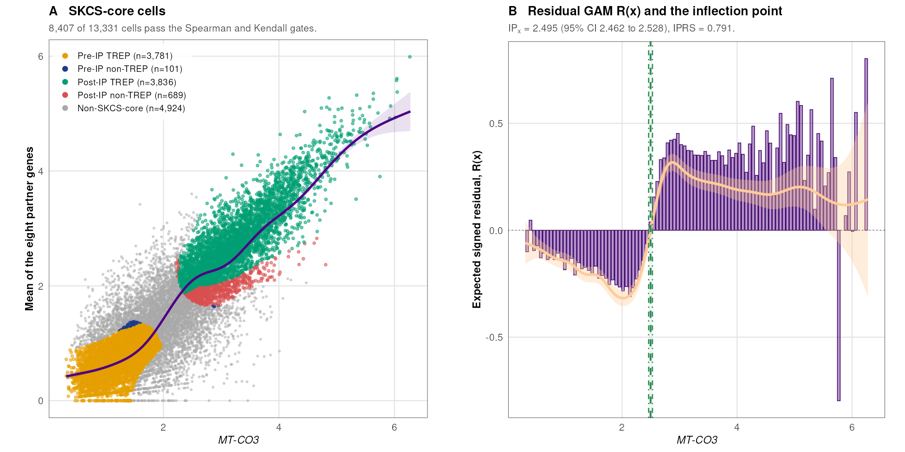
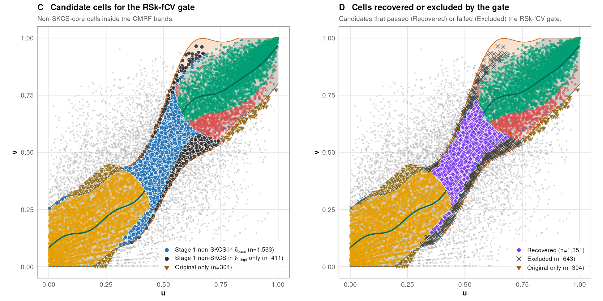
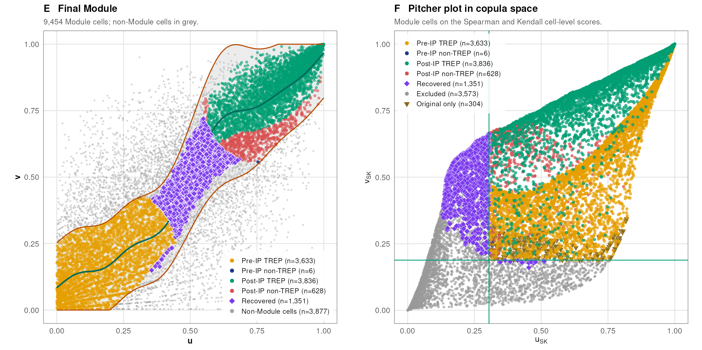

<div align="center">


# cepip

[](LICENSE.md)
[](DESCRIPTION)
[](https://github.com/kahkengwong/cepip/actions/workflows/R-CMD-check.yaml)
[](https://doi.org/10.1016/j.cmpb.2026.109372)
[](https://www.biorxiv.org/content/10.64898/2026.10.22.761284v1)
[](https://huggingface.co/datasets/kahkengwong/cepip_example)
[](https://github.com/kahkengwong/CEP-IP_with_CMRF_in_SEA-AD)

### Author: Kah Keng Wong [](https://orcid.org/0000-0001-7359-6202)

R package for **CEP-IP** (cell explanatory power with inflection point) and its extensions **SKCS** (Spearman-Kendall cell-level score) and **CMRF** (copula monotone recovery filter) for co-expression analysis in single-cell data.

<table>
<tr><th align="center" colspan="3">Table of Contents</th></tr>
<tr><th align="left">No.</th><th align="left">Section</th><th align="left">Descriptions</th></tr>
<tr><td align="left" colspan="3"><b>About the package</b></td></tr>
<tr><td align="left"><b>1</b></td><td align="left"><a href="#1-overview">Overview</a></td><td align="left">Aims of the package and its functions</td></tr>
<tr><td align="left" colspan="3"><b>Getting started</b></td></tr>
<tr><td align="left"><b>2</b></td><td align="left"><a href="#2-install">Install</a></td><td align="left">Installation from GitHub</td></tr>
<tr><td align="left"><b>3</b></td><td align="left"><a href="#3-quick-start">Quick Start</a></td><td align="left">A first run on simulated data</td></tr>
<tr><td align="left"><b>4</b></td><td align="left"><a href="#4-worked-example">Worked Example</a></td><td align="left">Each step of the method on the SEA-AD example data</td></tr>
<tr><td align="left" colspan="3"><b>Outputs and reproduction</b></td></tr>
<tr><td align="left"><b>5</b></td><td align="left"><a href="#5-output-of-cepip_save">Output of <code>cepip_save()</code></a></td><td align="left">Tables and plots written by the package</td></tr>
<tr><td align="left"><b>6</b></td><td align="left"><a href="#6-reproducing-the-sea-ad-analysis">Reproducing the SEA-AD Analysis</a></td><td align="left">698 published values checked</td></tr>
<tr><td align="left"><b>7</b></td><td align="left"><a href="#7-reproducing-the-cep-ip-analysis-of-the-pca-dataset">Reproducing the PCa Analysis</a></td><td align="left">133 published values of the CEP-IP paper checked</td></tr>
<tr><td align="left" colspan="3"><b>Using this work</b></td></tr>
<tr><td align="left"><b>8</b></td><td align="left"><a href="#8-license-and-data-terms">License and Data Terms</a></td><td align="left">MIT License and the terms of the example data</td></tr>
<tr><td align="left"><b>9</b></td><td align="left"><a href="#9-citation">Citation</a></td><td align="left">Citations of the methods</td></tr>
</table>

</div>

<br>

---

## 1. Overview
cepip analyzes the co-expression of a gene of interest (GOI) with a set of partner genes in single-cell data. The partner genes are genes whose expression rises with the GOI across cells. Their mean in each cell is called the composite. In most datasets, only some of the cells follow this relationship closely. cepip identifies these cells, finds the GOI level at which the relationship changes, and relates the result to donor-level outcomes.

The package has three parts:
- **CEP-IP** fits a generalized additive model (GAM) of the composite on the GOI. Each cell gets an explanatory power (EP), which measures how well the fitted curve explains that cell. The top cells by EP are the TREP cells. The inflection point (IP) splits the cells into Pre-IP and Post-IP cells. CEP-IP was published in [*CMPB* (2026)](https://doi.org/10.1016/j.cmpb.2026.109372).
- **SKCS** splits the global Spearman and Kendall correlations into a score for each cell. The cells with high scores on both form the SKCS-core.
- **CMRF** works in copula space, where each axis is replaced by the ranks of its values. It builds a band around the curve of the SKCS-core cells, and a cross-validated gate recovers the cells outside the core that follow the same curve. The SKCS-core cells inside the band and the recovered cells form the Module.

The downstream functions compute the share of each donor's cells in each group, the differential expression between groups, and the association of a donor-level measure with clinical outcomes.

The functions, in the order of the analysis:

| Step | Function | Output |
|---|---|---|
| Partner screen | `cepip_screen()` | GOIs ranked by their number of dual-filter partner genes (Spearman r<sub>s</sub> and Kendall τ<sub>b</sub>) |
| Composite | `cepip_composite()` | mean expression of the partner genes per cell |
| CEP-IP GAM | `cepip_fit()` | GAM-REML-PRSS fit (k by the lowest PRSS), deviance explained (DE) |
| EP and TREP | `cepip_ep()` | explanatory power per cell and the TREP cells (top round(n x DE) by EP) |
| Inflection point | `cepip_ip()` | IP from the residual GAM R(x), 95% CI, IP<sub>y</sub>, IPRS |
| SKCS | `cepip_skcs()` | per-cell Spearman and Kendall contributions and the SKCS-core cells |
| CMRF band | `cepip_band()` | spine, δ<sub>base</sub> and δ<sub>adapt</sub> band in copula space (Stage 1) |
| CMRF gate | `cepip_cmrf()` | RSk-fCV gate (Stage 2) and the Module (OriRef plus Recovered cells) |
| Validation1 | `cepip_validate()` | GAM refit on the Module cells and label agreement |
| Groups per donor | `cepip_donor()` | share of each donor's cells in the Module Post-IP and other groups |
| DEGs | `cepip_deg()` | donor-paired differential expression between two groups |
| Donor outcomes | `cepip_associate()` | OLS of donor outcomes on a donor measure with covariates |
| All steps | `cepip()` | runs CEP-IP, and SKCS and CMRF when asked |
| Output | `cepip_save()` | numbered tables (one workbook) and plots in one folder |

Each step has a plot function: `plot_screen()`, `plot_prss()`, `plot_fit()`, `plot_residual()`, `plot_pitcher()`, `plot_copula()`, `plot_band()`, `plot_rskfcv()`, `plot_module()`, `plot_validate()`, `plot_donor()`, `plot_deg()`, and `plot_associate()`.

The full analysis of the [SEA-AD preprint](https://www.biorxiv.org/content/10.64898/2026.10.22.761284v1), with all scripts, the container, and the console logs, is in the repository [CEP-IP_with_CMRF_in_SEA-AD](https://github.com/kahkengwong/CEP-IP_with_CMRF_in_SEA-AD).

---

## 2. Install

```r
# install.packages("remotes")
remotes::install_github("kahkengwong/cepip")
```

The class tests of CMRF use the suggested packages clinfun, Hmisc, and energy. The screen uses pcaPP for a fast Kendall tau-b when it is installed.

---

## 3. Quick Start

```r
library(cepip)
d <- cepip_toy                                  # 1,200 simulated cells, 12 donors
res <- cepip(d$x, d$y, donor = d$donor, id = d$id, cmrf = TRUE)
res
plot_fit(res)
plot_module(res$cmrf)
cepip_save(list(toy = res), file.path(tempdir(), "toy_output"))
```

- `skcs = TRUE` adds SKCS. `cmrf = TRUE` adds SKCS, CMRF, and Validation1. CMRF always uses the CEP-IP inflection point.
- With `donor`, every GAM includes a donor random intercept and weights each cell by 1 / (cells of its donor).
- `workers` runs the GAM k searches and the RSk-fCV gate in parallel.

> [!NOTE]
> `cepip(x, y)` with the default settings is the published CEP-IP, except for one setting. Cells are labelled Pre-IP or Post-IP on the response axis (y < IP<sub>y</sub>). `ip_axis = "x"` gives the published split on the GOI axis (x < IP<sub>x</sub>).

> [!IMPORTANT]
> The package does not transform the data. The published CEP-IP analyses used log2(value + 1) of Seurat log-normalized data, and the SEA-AD analysis used ln(CP10K + 1). The default thresholds (screen, DEGs, outcomes, and covariates) are those of the published analyses. They should be adjusted to each dataset and question.

---

## 4. Worked Example
This section runs cepip on the SEA-AD example data and explains the method two panels at a time. The data are the 13,331 PVM_3 cells of the neocortical regions (NeoC). The GOI is *MT-CO3*, and the composite is the mean of its eight mitochondrial partner genes. The run uses the settings of the paper and gives the published values.

```r
pvm3 <- cepip_example("pvm3")
d    <- pvm3[pvm3$region_set == "NeoC", ]
mt8  <- c("MT-ATP6", "MT-CO2", "MT-ND3", "MT-ND4", "MT-CYB", "MT-ND1", "MT-ND2", "MT-CO1")
y    <- cepip_composite(d, mt8)
res  <- cepip(d[["MT-CO3"]], y, donor = d$donor, id = d$barcode, cmrf = TRUE, ip_k = 10,
              y_spine = d$composite_part8, workers = 4)   # y_spine: composite of the paper's data export
```

The code under each figure is condensed from the package source, and the file is named in its first line. The figures are drawn by [`assets/readme_figure.R`](assets/readme_figure.R). The six panels are also in one figure: [`assets/cepip_example_figure.png`](assets/cepip_example_figure.png).

### 4.1 SKCS-core Cells and the Inflection Point (Panels A and B)

<p align="center"></p>

**Aims.** Panel A shows the cells that follow the global monotonic relationship between the GOI and its partner genes. Panel B finds the GOI level at which the best-explained cells move from below the population curve to above it. This level is the inflection point (IP).

**Methods.**
- The global Spearman r<sub>s</sub> and Kendall τ<sub>b</sub> are sums of contributions of single cells, so each cell can be given its own score.
- For n cells with ranks R<sub>x,i</sub> on the GOI and R<sub>y,i</sub> on the composite (middle rank R̄ = (n + 1)/2), the two scores are:

$$S_i = \frac{4\,(R_{x,i} - \bar{R})(R_{y,i} - \bar{R})}{(n-1)^2} \qquad\qquad K_i = \frac{C_i - D_i}{n-1}$$

- C<sub>i</sub> and D<sub>i</sub> are the concordant and discordant pairs that involve cell *i*.
- Without ties, r<sub>s</sub> is close to three times the mean S<sub>i</sub>, and τ<sub>b</sub> is the mean K<sub>i</sub>.
- Cells that pass both gates, S<sub>i</sub> > 0.05 and K<sub>i</sub> > 0.5, are the SKCS-core cells.
- The CEP-IP GAM is then refitted on the SKCS-core cells (purple line in A).

```r
# R/skcs.R (condensed)
Si_norm <- 4 * (rx - mean(rx)) * (ry - mean(ry)) / (n - 1)^2   # S_i above; rx, ry: ranks
Ki      <- cd / sqrt((n - 1 - tx) * (n - 1 - ty))               # K_i; tx, ty: ties of cell i (tau-b form)
is_core <- (Si_norm > 0.05) & (Ki > 0.5)
```

> [!NOTE]
> S<sub>i</sub> in this README is the normalized score `Si_norm` of the package. With ties, K<sub>i</sub> uses the tau-b denominator, as in the code above.

- For the IP, the CEP-IP GAM f is fitted on all cells, and the top round(n x DE) cells by explanatory power (EP) are kept.
- The residuals y - f(x) of these cells are fitted by a residual GAM, R(x).
- IP<sub>x</sub> is the first point where R(x) crosses zero from negative to positive.
- The 95% CI comes from the roots of the R(x) ± 1.96 SE bands.
- The IP reliability score (IPRS) is the mean of five criteria: CI precision, a test of post-IP against pre-IP residuals, the slope of R(x) at the IP, the ribbon width, and the smoothness of R(x).

```r
# R/ip.R (condensed)
rm <- mgcv::gam(residual ~ s(GOI, bs = "tp", k = 20) + s(donor, bs = "re"),
                data = rd, weights = w, method = "REML")   # rd: residuals of the top-EP cells
i  <- which(r_hat[-g] < 0 & r_hat[-1] > 0)[1]               # r_hat: R(x) on a grid of g points
ip <- x_seq[i] - r_hat[i] * (x_seq[i + 1] - x_seq[i]) / (r_hat[i + 1] - r_hat[i])
```

**Results.**
- **A.** Of the 13,331 cells, 8,407 (63.1%) are SKCS-core cells: Pre-IP TREP 3,781, Pre-IP non-TREP 101, Post-IP TREP 3,836, and Post-IP non-TREP 689. The other 4,924 cells (grey) do not pass both gates.
- **B.** The binned residuals of the top-EP cells are negative below the IP and positive above it. R(x) crosses zero at IP<sub>x</sub> = 2.4953 (95% CI 2.4616 to 2.5280). The population curve gives IP<sub>y</sub> = 1.6648, and the IPRS is 0.791 (Strong). Cells are labelled Pre-IP or Post-IP by y < IP<sub>y</sub> (the default `ip_axis = "y"`).

### 4.2 The CMRF Band and the RSk-fCV Gate (Panels C and D)

<p align="center"></p>

**Aims.** The fixed S<sub>i</sub> and K<sub>i</sub> gates leave out cells that still follow the relationship. Panel C builds a band around the curve of the SKCS-core cells and finds the other cells that fall inside it. Panel D tests these candidate cells and keeps those that do not make the monotonic curve worse.

**Methods.**
- Both axes are moved to copula space: u = rank(x)/(n + 1) and v = rank(y)/(n + 1). This removes the scale of each gene and keeps only the order of the cells.
- A GAM of v on u, fitted on the SKCS-core TREP cells, gives the spine g(u) (green line).
- The base half-width δ<sub>base</sub> is the 95% quantile of |v - g(u)| over the SKCS-core cells, with each donor weighted equally (blue band, dashed edges).
- The adaptive band widens δ<sub>base</sub> around the IP with a Gaussian kernel (orange band):

$$\delta_{adapt}(u) = \delta_{base}\left(1 + \kappa\, e^{-(u - IP_u)^2 / (2\,bw^2)}\right), \qquad \kappa = 0.5,\ bw = 0.1$$

- Stage 1 sorts the cells by the band:
  - SKCS-core cells inside the band are the reference set (Original + Refined, OriRef)
  - SKCS-core cells outside the band are "Original only" and leave the Module
  - non-SKCS-core cells inside the band are the candidates

```r
# R/band.R (condensed)
u <- rank(x) / (n + 1); v <- rank(y) / (n + 1)                 # copula space
delta_base  <- weighted_quantile(abs(v[core] - g_u[core]), w_core, 0.95)
delta_adapt <- delta_base * (1 + kappa * exp(-(u - IP_u)^2 / (2 * bw^2)))
pass1 <- abs(v - g_u) <= delta_adapt                            # candidates: !core & pass1
```

- Stage 2 is the RSk-fCV gate (repeated stratified k-fold cross-validation).
- Curve A is a monotone (isotonic) fit of v on u for the OriRef cells. Curve B is the same fit for the OriRef cells plus the candidates.
- Each curve is cross-validated with 5 folds stratified by deciles of u, repeated 40 times. This gives 200 test RMSE values per curve.
- Curve B fails the gate when both conditions hold:
  - its RMSE is higher than that of curve A by a paired Wilcoxon test (p < 0.05)
  - the relative increase in median RMSE (dRMSE) is larger than the background variability of curve A (BV)
- While curve B fails, the candidate farthest from the monotone curve is removed and curve B is refitted.
- The candidates left when the gate closes are the Recovered cells.

```r
# R/cmrf.R (condensed): one iteration of the gate
p   <- wilcox.test(rmse_B, rmse_A, paired = TRUE, alternative = "greater")$p.value
eff <- median(rmse_B - rmse_A) / median(rmse_A)                 # dRMSE
bv  <- IQR(rmse_A) / median(rmse_A)                             # background variability
if (p < 0.05 && eff > bv) active[worst] <- FALSE                # remove the candidate farthest from the curve
```

> [!TIP]
> `cepip_band()` is fast. It can be run with several values of `kappa` and `bw` and checked with `plot_band()` before the slower gate of `cepip_cmrf()`. `plot_rskfcv()` shows the folds and the test RMSE of curves A and B.

**Results.**
- **C.** In Stage 1, 1,994 non-SKCS-core cells pass: 1,583 inside δ<sub>base</sub> (blue) and 411 only inside the widened part of δ<sub>adapt</sub> (black). Of the SKCS-core cells, 304 lie outside the band (Original only, tan triangles). The other 8,103 SKCS-core cells form the OriRef set.
- **D.** The gate removed 643 of the 1,994 candidates (crosses) and kept 1,351 (Recovered, purple diamonds). The removed cells lie along the outer edges of the band, and the Recovered cells fill the band around the IP.

### 4.3 The Final Module and the Pitcher Plot (Panels E and F)

<p align="center"></p>

**Aims.** Panel E shows the final Module. Panel F places the cells on the two cell-level scores, S<sub>i</sub> and K<sub>i</sub>, and shows the fixed gate that the Recovered cells failed.

**Methods.**
- The Module is the OriRef cells plus the Recovered cells.
- The other cells are non-Module cells: the Original-only cells and the Excluded cells (the cells outside the band and the candidates removed by the gate).
- Validation1 refits the CEP-IP GAM on the Module cells and recomputes EP and the TREP cells. It then compares the new four-group labels of the OriRef cells with their original labels.
- The pitcher plot puts every cell in copula space on its two scores, u<sub>SK</sub> = rank(S<sub>i</sub>)/(n + 1) and v<sub>SK</sub> = rank(K<sub>i</sub>)/(n + 1).
- The green lines mark the two fixed gates, S<sub>i</sub> = 0.05 and K<sub>i</sub> = 0.5.

```r
# R/cmrf.R (condensed)
cls <- ifelse(core & pass, "Original + Refined", ifelse(core, "Original only",
       ifelse(pass, "Recovered", "Excluded")))
in_module <- cls %in% c("Original + Refined", "Recovered")
u_SK <- rank(Si_norm) / (n + 1); v_SK <- rank(Ki) / (n + 1)    # pitcher plot coordinates
```

**Results.**
- **E.** The Module is the OriRef cells in their four groups plus the Recovered cells (purple). The Recovered cells fill the gap between the Pre-IP and Post-IP cells that the fixed gates left empty (panel A). In Validation1, the GAM refitted on the Module has a DE of 0.8741, and 97.5% of the OriRef cells keep their four-group label.
- **F.** The Recovered cells sit where the Post-IP (green) and Pre-IP (amber) branches meet. Most of them lie left of the S<sub>i</sub> gate line and above the K<sub>i</sub> gate line, so they failed only the S<sub>i</sub> gate. CMRF recovered them because they follow the same curve as the SKCS-core cells in copula space (panel E). The Excluded cells (grey) lie below or to the left of the gate lines.

---

## 5. Output of `cepip_save()`

One folder per arm, with no subfolders. Files are numbered in pipeline order, and the region set (or other subset) is part of each name.

| File | Content |
|---|---|
| `00_settings.txt`, `00_log.txt` | settings, versions, summaries, and the console log |
| `<arm>_cepip_tables.xlsx` | one sheet per table, from `01_screen` to `14_associate` |
| `<arm>_cepip_cells.xlsx` | the cell-level tables, when they are too large for the first workbook |
| `02_prss` to `14_associate` (.png and .pdf) | the plots |

---

## 6. Reproducing the SEA-AD Analysis

- `cepip_example()` downloads the example data of the paper from Hugging Face ([kahkengwong/cepip_example](https://huggingface.co/datasets/kahkengwong/cepip_example)):
  - the 24,463 Micro-PVM_3-SEAAD cells with *MT-CO3* > 0
  - the 2,511 cells of the HKG8 control arm
  - the donor table
  - the DEG matrices
- The files are kept in the R user cache folder, and `cepip_example_clear()` deletes them.
- The script `reproduce_seaad.R` runs three arms:
  - PVM_3: *MT-CO3* against the mean of its eight mitochondrial partner genes (the arm of the paper)
  - HKG8 control: *ACTB* against the mean of eight housekeeping genes, on the housekeeping-gene control cells of the paper
  - same-cell housekeeping control: *MT-CO3* against the mean of nine housekeeping genes, on the PVM_3 cells (GAM step only)
- It compares every result with the published value in `inst/reference/seaad_reference.csv`.
- The arguments are the output folder, the number of workers, and, optionally, a folder that already holds the example files (without it, the files are downloaded).

```sh
Rscript "$(Rscript -e 'cat(system.file("scripts", "reproduce_seaad.R", package = "cepip"))')" cepip_seaad 4
```

| Value | PVM_3 NeoC | PVM_3 NonNeoC | HKG8 NeoC | HKG8 NonNeoC |
|---|---|---|---|---|
| Cells | 13,331 | 11,132 | 1,432 | 1,079 |
| IP<sub>x</sub> | 2.4953 | 2.6572 | 1.5552 | 1.8130 |
| IPRS | 0.791 | 0.819 | 0.639 | 0.571 |
| SKCS-core cells | 8,407 | 6,941 | 250 | 199 |
| OriRef / Recovered | 8,103 / 1,351 | 6,646 / 1,089 | 239 / 287 | 191 / 240 |
| Removed by the gate | 643 | 619 | 65 | 22 |

- The script checks 698 published values, including 56 DEG values. All of them agree within their tolerance.
- Each arm gets one folder with its tables, plots, and console log. The check is written to `reproduction_check.csv` and `reproduction_check_log.txt` in the output folder.
- The run took 9 minutes with 8 workers (R 4.6.1, mgcv 1.9-4).

> [!NOTE]
> The DEG step runs only when the DEG matrices are available. When a data folder is given, it must hold `pvm3_deg_NeoC.rds` and `pvm3_deg_NonNeoC.rds`. Without them, the 56 DEG values are marked NOT RUN in `reproduction_check.csv`.

---

## 7. Reproducing the CEP-IP Analysis of the PCa Dataset

- `inst/scripts/reproduce_cmpb_pca.R` reruns the prostate cancer (PCa) analysis of the published CEP-IP paper.
- It fits *TRPM4* against the mean of seven ribosomal genes in each of the seven tumor samples. As in the paper, the samples are analyzed without donors, and the IP splits the cells on the *TRPM4* axis (`ip_axis = "x"`).
- It needs `GSE185344_Seurat_processed.RData` (9.5 GB) from the Hugging Face dataset [kahkengwong/CEP-IP_Framework](https://huggingface.co/datasets/kahkengwong/CEP-IP_Framework) and the SeuratObject package.
- When Supplementary Table 10 of the paper is also given, the script compares the EP of every cell as well. The table (`Supplementary_Table_10_Deviance_Components__EP.xlsx`) is in the same Hugging Face dataset as the .RData, and in the paper's [Zenodo](https://doi.org/10.5281/zenodo.19360154) record.
- The arguments are the output folder, the number of workers, the folder with the .RData, and, optionally, Supplementary Table 10.

```sh
Rscript "$(Rscript -e 'cat(system.file("scripts", "reproduce_cmpb_pca.R", package = "cepip"))')" cepip_cmpb_pca 4 <folder with the .RData> <Supplementary Table 10 .xlsx>
```

| Sample | Cells | k | DE | IP<sub>x</sub> | IPRS |
|---|---|---|---|---|---|
| HYW_4701 | 985 | 6 | 0.3155 | 3.7963 | 0.696 |
| HYW_4847 | 820 | 3 | 0.2865 | 2.1185 | 0.670 |
| HYW_4880 | 337 | 6 | 0.5887 | 3.2237 | 0.769 |
| HYW_4881 | 1,232 | 10 | 0.8346 | 3.2233 | 0.768 |
| HYW_5386 | 156 | 4 | 0.3095 | 2.3856 | 0.631 |
| HYW_5742 | 1,468 | 4 | 0.5106 | 3.3212 | 0.719 |
| HYW_5755 | 857 | 3 | 0.5276 | 3.4270 | 0.691 |

- The script checks 133 published values from Supplementary Tables 10 and 15 (`inst/reference/cmpb_pca_reference.csv`):
  - the cell count, total EDF, DE, and TREP cells
  - the IP, its CI, and the statistical test
  - the IPRS and its five components
- All 133 agree within their tolerance.
- The EP of all 5,855 cells agrees with Supplementary Table 10 to a relative difference of 3e-11 or less.
- The comparison is written to `cmpb_pca_check.xlsx`, and the summary to `reproduction_check_log.txt`, in the output folder.

> [!TIP]
> The first run saves the GAM data of the seven samples as `pca_trpm4_ribo_cells.csv` in the output folder. Later runs with the same output folder read this file, so the 9.5 GB .RData is needed only once.

---

## 8. License and Data Terms

The package code is licensed under the [MIT License](LICENSE.md).

The example data are derived from the Seattle Alzheimer's Disease Brain Cell Atlas (SEA-AD) of the Allen Institute for Brain Science. Their use is subject to the [Allen Institute Terms of Use](https://alleninstitute.org/legal/terms-of-use) (noncommercial research use) and [Citation Policy](https://alleninstitute.org/legal/citation-policy). Commercial use needs the written permission of the Allen Institute.

The example data and the example figures in this README are derived from the SEA-AD data ([SEA-AD portal](https://brain-map.org/consortia/sea-ad/our-data)), described in:

- M.I. Gabitto, K.J. Travaglini, V.M. Rachleff, E.S. Kaplan, B. Long, et al., Integrated multimodal cell atlas of Alzheimer's disease, Nat Neurosci, 27 (2024) 2366-2383. https://doi.org/10.1038/s41593-024-01774-5
- K.J. Travaglini, M.I. Gabitto, Y. Ding, A. Agrawal, N. Postupna, et al., Multiregional single-cell profiling reveals shared and specialized cellular vulnerability in Alzheimer's disease, bioRxiv, (2026). https://www.biorxiv.org/content/10.64898/2026.07.01.734821v1

---

## 9. Citation

If you use cepip, please cite:

K.K. Wong. CEP-IP: An explainable framework for cell subpopulation identification in single-cell transcriptomics. *Computer Methods and Programs in Biomedicine*, 282 (2026) 109372. https://doi.org/10.1016/j.cmpb.2026.109372

If you use SKCS or CMRF, please also cite:

K.K. Wong. CEP-IP with CMRF in SEA-AD Microglia: A Mitochondrial Co-expression Module Linked to Cognition. *bioRxiv* (2026). https://www.biorxiv.org/content/10.64898/2026.10.22.761284v1

<details>
<summary><strong>BibTeX (click to expand)</strong></summary>

```bibtex
@article{Wong2026CEPIP,
  author  = {Wong, Kah Keng},
  title   = {{CEP-IP}: An explainable framework for cell subpopulation identification in single-cell transcriptomics},
  journal = {Computer Methods and Programs in Biomedicine},
  volume  = {282},
  pages   = {109372},
  year    = {2026},
  doi     = {10.1016/j.cmpb.2026.109372}
}

@article{Wong2026SEAAD,
  author  = {Wong, Kah Keng},
  title   = {{CEP-IP} with {CMRF} in {SEA-AD} Microglia: A Mitochondrial Co-expression Module Linked to Cognition},
  journal = {bioRxiv},
  year    = {2026},
  doi     = {10.64898/2026.10.22.761284},
  url     = {https://www.biorxiv.org/content/10.64898/2026.10.22.761284v1}
}
```

</details>
