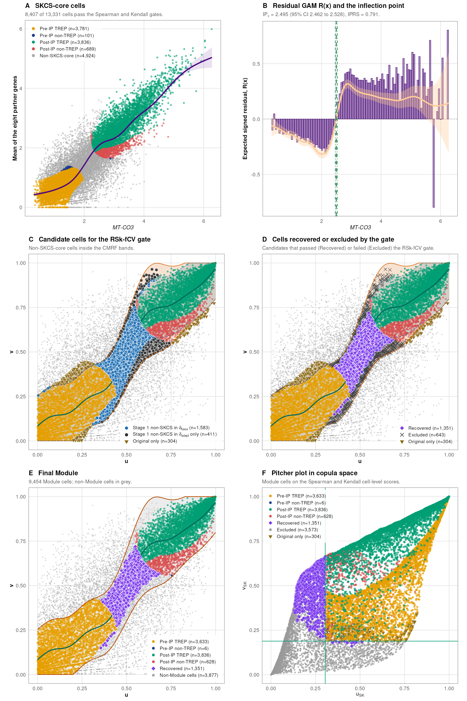

<div align="center">


# cepip

[](LICENSE.md)
[](DESCRIPTION)
[](https://doi.org/10.1016/j.cmpb.2026.109372)
[](https://doi.org/BIORXIV_DOI)
[](https://huggingface.co/datasets/kahkengwong/cepip_example)
[](https://github.com/kahkengwong/CEP-IP_with_CMRF_in_SEA-AD)

### Author: Kah Keng Wong [](https://orcid.org/0000-0001-7359-6202)

</div>

R package for **CEP-IP** (cell explanatory power with inflection point) and its extensions **SKCS** (Spearman-Kendall cell-level score) and **CMRF** (copula monotone recovery filter), for co-expression analysis in single-cell data.

The full analysis of the SEA-AD paper, with all scripts, the container, and the console logs, is in the repository [CEP-IP_with_CMRF_in_SEA-AD](https://github.com/kahkengwong/CEP-IP_with_CMRF_in_SEA-AD).

## 1. What it does

| Step | Function | Output |
|---|---|---|
| Partner screen | `cepip_screen()` | GOIs ranked by their number of dual-filter partner genes (Spearman rs and Kendall tau-b) |
| Composite | `cepip_composite()` | mean expression of the partner genes per cell |
| CEP-IP GAM | `cepip_fit()` | GAM-REML-PRSS fit (k by the lowest PRSS), deviance explained (DE) |
| EP and TREP | `cepip_ep()` | explanatory power per cell and the TREP cells (top round(n x DE) by EP) |
| Inflection point | `cepip_ip()` | IP from the residual GAM R(x), 95% CI, IPy, IPRS |
| SKCS | `cepip_skcs()` | per-cell Spearman and Kendall contributions and the SKCS-core cells |
| CMRF band | `cepip_band()` | spine, delta_base and delta_adapt band in copula space (Stage 1) |
| CMRF gate | `cepip_cmrf()` | RSk-fCV gate (Stage 2) and the Module (OriRef plus Recovered cells) |
| Validation1 | `cepip_validate()` | GAM refit on the Module cells and label agreement |
| Groups per donor | `cepip_donor()` | share of each donor's cells in the Module Post-IP and other groups |
| DEGs | `cepip_deg()` | donor-paired differential expression between two groups |
| Donor outcomes | `cepip_associate()` | OLS of donor outcomes on a donor measure with covariates |
| All steps | `cepip()` | runs CEP-IP, and SKCS and CMRF when asked |
| Output | `cepip_save()` | numbered tables (one workbook) and plots in one folder |

Each step has a plot function: `plot_screen()`, `plot_prss()`, `plot_fit()`, `plot_residual()`, `plot_pitcher()`, `plot_copula()`, `plot_band()`, `plot_rskfcv()`, `plot_module()`, `plot_validate()`, `plot_donor()`, `plot_deg()`, and `plot_associate()`.

## 2. Install

```r
# install.packages("remotes")
remotes::install_github("kahkengwong/cepip")
```

The class tests of CMRF use the suggested packages clinfun, Hmisc, and energy. The screen uses pcaPP for a fast Kendall tau-b when it is installed.

## 3. Quick start

```r
library(cepip)
d <- cepip_toy                                  # 1,200 simulated cells, 12 donors
res <- cepip(d$x, d$y, donor = d$donor, id = d$id, cmrf = TRUE)
res
plot_fit(res)
plot_module(res$cmrf)
cepip_save(list(toy = res), "toy_output")
```

* `cepip(x, y)` with the default settings is the published CEP-IP. Cells are labelled Pre-IP or Post-IP on the response axis (y < IPy); `ip_axis = "x"` gives the published split on the GOI axis.
* `skcs = TRUE` adds SKCS. `cmrf = TRUE` adds SKCS, CMRF, and Validation1. CMRF always uses the CEP-IP inflection point.
* With `donor`, every GAM includes a donor random intercept and weights each cell by 1 / (cells of its donor).
* The package does not transform the data. The published CEP-IP analyses used log2(value + 1) of Seurat log-normalized data; the SEA-AD analysis used ln(CP10K + 1).
* The default thresholds (screen, DEGs, outcomes, and covariates) are those of the published analyses. They should be adjusted to each dataset and question.

### Example output

<p align="center"></p>

**Example output on the SEA-AD example data.** The 13,331 PVM_3 cells of the neocortical regions, with *MT-CO3* against the mean of its eight mitochondrial partner genes and the settings of the paper. The run gives the published values (IP<sub>x</sub> 2.4953, IPRS 0.791).
- **A.** SKCS-core cells (four groups) and non-SKCS-core cells (grey).
- **B.** Residual GAM R(x): binned mean residuals (bars) and the fitted R(x). Its negative-to-positive zero crossing gives the inflection point (IP).
- **C.** The CMRF bands in copula space and the candidate cells of the RSk-fCV gate.
- **D.** Candidate cells recovered or excluded by the RSk-fCV gate.
- **E.** The final Module, with the non-Module cells in grey.
- **F.** The pitcher plot in copula space.

The figure is drawn by [`assets/readme_figure.R`](assets/readme_figure.R) from the result of `cepip()`.

## 4. Output of `cepip_save()`

One folder per arm, with no subfolders. Files are numbered in pipeline order, and the region set (or other subset) is part of each name.

| File | Content |
|---|---|
| `00_settings.txt`, `00_log.txt` | settings, versions, summaries and the console log |
| `<arm>_cepip_tables.xlsx` | one sheet per table, from `01_screen` to `14_associate` |
| `<arm>_cepip_cells.xlsx` | the cell-level tables, when they are too large for the first workbook |
| `02_prss` to `14_associate` (.png and .pdf) | the plots |

## 5. Reproducing the SEA-AD analysis

`cepip_example()` downloads the example data of the paper from Hugging Face ([kahkengwong/cepip_example](https://huggingface.co/datasets/kahkengwong/cepip_example)): the 24,463 Micro-PVM_3-SEAAD cells with MT-CO3 > 0, the 2,511 cells of the HKG8 control arm, the donor table, and the DEG matrices. The files are kept in the R user cache folder, and `cepip_example_clear()` deletes them. The script below runs the PVM_3 arm, the HKG8 control arm, and the same-cell housekeeping control and compares every value with the published one (`inst/reference/seaad_reference.csv`).

```sh
Rscript "$(Rscript -e 'cat(system.file("scripts", "reproduce_seaad.R", package = "cepip"))')" cepip_seaad 4
```

| Value | PVM_3 NeoC | PVM_3 NonNeoC | HKG8 NeoC | HKG8 NonNeoC |
|---|---|---|---|---|
| Cells | 13,331 | 11,132 | 1,432 | 1,079 |
| IPx | 2.4953 | 2.6572 | 1.5552 | 1.8130 |
| IPRS | 0.791 | 0.819 | 0.639 | 0.571 |
| SKCS-core cells | 8,407 | 6,941 | 250 | 199 |
| OriRef / Recovered | 8,103 / 1,351 | 6,646 / 1,089 | 239 / 287 | 191 / 240 |
| Removed by the gate | 643 | 619 | 65 | 22 |

The script checks 722 published values, including 56 DEG values, and all of them agree within their tolerance. It took 9 minutes with 8 workers (R 4.6.1, mgcv 1.9-4).

## 6. Reproducing the CEP-IP analysis of the PCa dataset

`inst/scripts/reproduce_cmpb_pca.R` reruns the prostate cancer (PCa) analysis of the published CEP-IP paper. It fits TRPM4 against the mean of seven ribosomal genes in each of the seven tumor samples, without donors and with the IP split on the TRPM4 axis (`ip_axis = "x"`), as in the paper. It needs `GSE185344_Seurat_processed.RData` (9.5 GB) from the Hugging Face dataset [kahkengwong/CEP-IP_Framework](https://huggingface.co/datasets/kahkengwong/CEP-IP_Framework) and the SeuratObject package. When Supplementary Table 10 of the paper is also given, the script compares the EP of every cell as well. The table (`Supplementary_Table_10_Deviance_Components__EP.xlsx`) is in the same Hugging Face dataset as the .RData, and in the paper's [Zenodo](https://doi.org/10.5281/zenodo.19360154) record.

```sh
Rscript "$(Rscript -e 'cat(system.file("scripts", "reproduce_cmpb_pca.R", package = "cepip"))')" cepip_cmpb_pca 4 <folder with the .RData> <Supplementary Table 10 .xlsx>
```

| Sample | Cells | k | DE | IPx | IPRS |
|---|---|---|---|---|---|
| HYW_4701 | 985 | 6 | 0.3155 | 3.7963 | 0.696 |
| HYW_4847 | 820 | 3 | 0.2865 | 2.1185 | 0.670 |
| HYW_4880 | 337 | 6 | 0.5887 | 3.2237 | 0.769 |
| HYW_4881 | 1,232 | 10 | 0.8346 | 3.2233 | 0.768 |
| HYW_5386 | 156 | 4 | 0.3095 | 2.3856 | 0.631 |
| HYW_5742 | 1,468 | 4 | 0.5106 | 3.3212 | 0.719 |
| HYW_5755 | 857 | 3 | 0.5276 | 3.4270 | 0.691 |

The script checks 133 published values from Supplementary Tables 10 and 15 (`inst/reference/cmpb_pca_reference.csv`): the cell count, total EDF, DE, TREP cells, the IP and its CI, the stat test, and the IPRS with its five components. All 133 agree within their tolerance. The EP of all 5,855 cells agrees with Supplementary Table 10 to a relative difference of 3e-11 or less.

## 7. Data terms

The example data are derived from the Seattle Alzheimer's Disease Brain Cell Atlas (SEA-AD) of the Allen Institute for Brain Science. Their use is subject to the [Allen Institute Terms of Use](https://alleninstitute.org/legal/terms-of-use) (noncommercial research use) and [Citation Policy](https://alleninstitute.org/legal/citation-policy). The package code is MIT licensed.

## 8. Citation

If you use cepip, please cite:

K.K. Wong. CEP-IP: An explainable framework for cell subpopulation identification in single-cell transcriptomics. *Computer Methods and Programs in Biomedicine*, 282 (2026) 109372. https://doi.org/10.1016/j.cmpb.2026.109372

If you use SKCS or CMRF, please also cite:

K.K. Wong. CEP-IP with CMRF in SEA-AD Microglia: A Mitochondrial Co-expression Module Linked to Cognition. *bioRxiv* (2026). https://doi.org/BIORXIV_DOI
